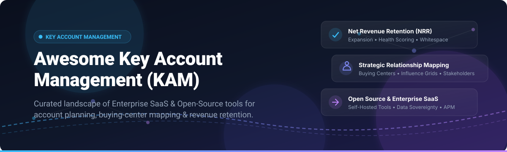

# 🎯 Awesome Key Account Management (KAM)

  

  
  
  
  
  
  

---

## 🧭 Overview & Ecosystem

A curated directory of top **Key Account Management (KAM)**, **Strategic Account Planning**, **Customer Health Scoring**, and **Revenue Lifecycle Platforms**. Whether you are an enterprise CRO mapping multi-stakeholder buying centers, a customer success leader driving Net Revenue Retention (NRR), or an engineering team seeking self-hosted, data-sovereign open-source solutions, this list covers category leaders and actively maintained projects.

* **Target Audience**: Strategic Account Directors, Key Account Managers (KAM), VP of Sales, Customer Success Operations (CSOps), Enterprise Architects, and RevOps Leaders.
* **Core Topics**: Relationship Mapping, White-Space Analysis, Account-Based Forecasting, Health Scoring, Org Chart Intelligence, Expansion Strategy, and Churn Prevention.

---

## 📑 Table of Contents

- [📊 Sector Overview & Market Dynamics](#-sector-overview--market-dynamics)
- [🏢 SaaS & Enterprise Hosted Platforms](#-saas--enterprise-hosted-platforms)
- [💻 Open-Source Projects & Frameworks](#-open-source-projects--frameworks)
- [🤝 How to Contribute](#-how-to-contribute)
- [💖 Support & Sponsorship](#-support--sponsorship)
- [📈 Star History](#-star-history)
- [⚖️ Disclaimer](#-disclaimer)

---

## 📊 Sector Overview & Market Dynamics

The global **Key Account Management (KAM) & Account Planning Software** sector was valued at approximately **$1.41 billion in 2025** and is projected to expand to **$3.38+ billion by 2032**, demonstrating a compound annual growth rate (**CAGR of 14.5%**).

Rather than a "winner-take-all" monopolistic market, the industry remains **moderately fragmented**: broad foundational CRM titans (such as Salesforce and Microsoft Dynamics) control baseline records and general pipeline management, while highly specialized best-of-breed platforms capture critical value by delivering purpose-built workflows—such as deep visual relationship mapping, account-whitespace analytics, and customer health scoring—fostering a multi-tier, composable ecosystem alongside emerging self-hosted open-source stacks.

---

## 🏢 SaaS & Enterprise Hosted Platforms

The following hosted solutions represent the leading dedicated platforms for enterprise key account planning, customer success intelligence, and relationship mapping. Sorted by company scale (descending).

| Platform | Pricing (Starting Tier) | Free Tier Limits / Trial | Company Size (Revenue / Valuation) | Key Capabilities |
| :--- | :--- | :--- | :--- | :--- |
| **[Salesforce Account Management](https://www.salesforce.com/)** | $25/user/month (Starter Suite, billed annually) | 30-day free trial (full access to core sales CRM features, guided setup, sample data, no credit card required) | ~$38B+ annual revenue / ~$280B+ market cap | Salesforce's native account management capabilities with account hierarchies, relationship maps, and account-based forecasting within Sales Cloud. |
| **[Gainsight](https://www.gainsight.com/)** | ~$100/user/month (~$1,200/user/year, Essentials tier; often 10-user minimum bundle) | No free tier; demo required (free viewer-only read licenses available on paid contracts) | ~$1.1B valuation (acquired by Vista Equity Partners) / ~$150M+ ARR | Customer success platform with 360° customer views, health scoring, playbooks, and AI-powered productivity tools for retention and expansion. |
| **[Planhat](https://www.planhat.com/)** | $1,150/month (Start-Up tier, billed annually at ~$14,000/year; includes unlimited seats) | No free tier; guided live demo & customized evaluation sandbox upon request | ~€490M valuation (~$530M, Series A 2022) / ~$25M+ ARR | Customer platform for professional services and customer success with project management, resource allocation, AI-powered sentiment analysis, and unified customer communication. |
| **[Totango](https://www.totango.com/)** | ~$1,000/month (~$12,000/year, Starter tier billed annually) | No free tier; guided live sandbox demo upon sales request | $146M+ raised ($100M Series D) / ~$40M+ ARR | Customer success platform recognized as a Leader in The Forrester Wave™: Customer Success Platforms, Q4 2025 with highest Strategy score. Features value realization methodology, AI-driven next best actions, and revenue intelligence. |
| **[Altify](https://altify.com/)** | $20/user/month (Altify Insights tier, billed annually) | No free tier; guided Salesforce AppExchange demo sandbox upon sales request | $84M cash acquisition (by Upland Software; later acquired by Gallant Capital) / ~$15M–$24M revenue | Strategic Revenue Execution system built on 30 years of proven sales methodology, bringing relationship intelligence and account strategy into Salesforce. Altify MaxAI delivers AI coaching inside Claude, Microsoft Copilot, ChatGPT, and Salesforce Agentforce. |
| **[ChurnZero](https://churnzero.com/)** | ~$1,000/month (~$12,000/year, starter annual contract) | No free tier; guided demo and custom evaluation sandbox upon request (offers separate standalone free CS AI web assistant) | $34.5M total funding (Series B via JMI Equity) / ~$27M–$35M ARR | Customer success platform with AI agents for renewal management, engagement automation, and expansion opportunity identification. |
| **[DemandFarm](https://www.demandfarm.com/)** | $20/user/month (Org Chart tier, 10-user minimum; Account Planner starts at $50/user/month) | No free tier; custom guided demo and account planning sandbox upon sales consultation | ~$18M estimated annual revenue | Digital account planning platform for key account management, enabling account tracking, white space analysis, relationship mapping, and upsell/cross-sell strategy development. Featured in Gartner's Account Planning Tools Guide for six consecutive years. Integrates with existing CRM systems. |
| **[Revegy](https://www.revegy.com/)** | $35/user/month (Base Relationship & Strategy Blueprint tier) | No free tier; customized live proof-of-concept sandbox upon sales request | Acquired by Dura Software / ~$3.7M estimated annual revenue | Sales optimization and enablement platform specializing in account planning, relationship mapping, opportunity planning, and strategic account execution. Helps enterprise sales teams navigate changing relationships and corporate politics in key accounts. |
| **[Membrain](https://www.membrain.com/)** | $49/user/month (Prospecting module; Account Growth module at $89/user/month; Lite seats at $19/user/month) | Free for life tier (up to 3 Full users & 5 Lite users, max 50 open sales projects, 1 active sales process, standard integrations) | ~$2M ARR | Sales Enablement CRM focused on B2B sales process management, adapting to any sales methodology with strong visualization and coaching tools. |
| **[Kapta](https://kapta.com/)** | $49/user/month (Basic entry tier; full team KAM deployments start at ~$1,000/month) | No free tier; guided sales demo with tailored pilot evaluation sandbox upon request | ~$675K venture funding (Seed via Rally Ventures) / ~$290K estimated annual revenue | Key account management platform that stores all client-related data in one place, eliminating information silos, tracking Voice of Customer (VoC), and fostering team communication. |

---

## 💻 Open-Source Projects & Frameworks

Open-source alternatives enable full data sovereignty, customizable account intelligence workflows, and self-hosted deployments without seat license overhead. Repositories are sorted by GitHub Stars_Count in descending order.

1. **[NocoDB](https://github.com/nocodb/nocodb)**   
   Open-source Airtable alternative that transforms PostgreSQL, MySQL, or SQL Server into a smart spreadsheet database. Widely adopted for building custom strategic account planners, relationship grids, client metadata registries, and territory whitespace trackers. AGPL-3.0 licensed.

2. **[Twenty](https://github.com/twentyhq/twenty)**   
   Modern, extensible open-source CRM built with TypeScript, React, and GraphQL. Provides native contact and company hierarchies, custom objects, relational views, and opportunity pipelines tailored for next-generation key account intelligence. AGPL-3.0 licensed.

3. **[Odoo](https://github.com/odoo/odoo)**   
   Extensible suite of open-source business apps featuring CRM, sales pipelines, recurring contract management, customer portals, and project accounting. Highly customizable for multi-division enterprise account mapping. LGPL-3.0 licensed.

4. **[Cal.com](https://github.com/calcom/cal.com)**   
   Enterprise open-source scheduling infrastructure. Critical for executive sponsor alignment, automating Quarterly Business Reviews (QBRs), multi-stakeholder meeting routing, and round-robin account manager engagement. AGPL-3.0 licensed.

5. **[PostHog](https://github.com/PostHog/posthog)**   
   All-in-one product analytics and user intelligence platform. Tracks account-level product adoption, telemetry signals, session replays, and feature engagement scores to provide quantitative health metrics and expansion alerts for key accounts. MIT licensed.

6. **[Novu](https://github.com/novuhq/novu)**   
   Open-source notification and workflow automation infrastructure. Powers mission-critical automated alerts for renewal reminders, contract expiration notices, account health score fluctuations, and milestone updates. MIT licensed.

7. **[ERPNext](https://github.com/frappe/erpnext)**   
   Comprehensive Python/Frappe open-source ERP system with native modules for CRM, customer lifecycle tracking, contracts, project delivery, and billing histories. Excellent for unifying customer touchpoints across enterprise accounts. GPL-3.0 licensed.

8. **[Chatwoot](https://github.com/chatwoot/chatwoot)**   
   Omnichannel customer communication platform providing unified conversation inboxes across email, WhatsApp, live chat, and social channels. Allows key account teams to centralize client stakeholder interactions and monitor team sentiment. AGPL-3.0 licensed.

9. **[Krayin CRM](https://github.com/krayin/laravel-crm)**   
   Modern open-source CRM framework built on Laravel. Features lead and deal lifecycle management, customizable pipelines, email integration, and extensible architectures for tracking multi-tiered corporate accounts. MIT licensed.

10. **[Documenso](https://github.com/documenso/documenso)**   
    Open-source digital signature platform. Accelerates key account contract execution, renewal agreements, Master Services Agreements (MSAs), and Statements of Work (SOWs) with self-hosted compliance and cryptographic verification. AGPL-3.0 licensed.

11. **[Crater](https://github.com/crater-invoice-inc/crater)**   
    Open-source invoicing and financial tracking solution. Tracks client billing records, payment milestones, account receivables, and recurring revenue schedules essential for holistic financial visibility into strategic accounts. AGPL-3.0 licensed.

12. **[SuiteCRM](https://github.com/SuiteCRM/SuiteCRM)**   
    Enterprise-grade open-source CRM with advanced modules for sales, customer support, and account lifecycle tracking. Features deep workflow engines and relationship charting capable of enterprise-scale customization. AGPL-3.0 licensed.

13. **[EspoCRM](https://github.com/espocrm/espocrm)**   
    Lightweight, flexible open-source web application for managing accounts, contacts, and opportunities. Includes custom relationship modeling, entity managers, and automated client workflows. GPL-3.0 licensed.

14. **[Corteza](https://github.com/cortezaproject/corteza)**   
    Low-code open-source digital work platform and alternative to Salesforce. Offers a full CRM suite, drag-and-drop workflow automation, granular permissions, and extensible data modeling for custom account planning portals. Apache 2.0 licensed.

15. **[CXM-Tool](https://github.com/antigravitysoham-eng/CXM-Tool)**   
    Full-stack Customer Experience Management platform built with React, Vite, Express, and SQLite. Features real-time retention and churn metrics dashboards, customer directories, onboarding health checks, contract lifecycle tracking, and an AI co-pilot for account intelligence.

---

### 🛠️ Recommended Stacks for Custom Self-Hosted KAM

Enterprise teams can assemble a custom, enterprise-grade, self-hosted KAM intelligence platform by combining:
* **Account Health & Lifecycle**: [CXM-Tool](https://github.com/antigravitysoham-eng/CXM-Tool) + [PostHog](https://github.com/PostHog/posthog) (Telemetry signals & customer analytics)
* **Core Account & Contact Hub**: [Twenty](https://github.com/twentyhq/twenty) or [SuiteCRM](https://github.com/SuiteCRM/SuiteCRM)
* **Stakeholder & Whitespace Planning**: [NocoDB](https://github.com/nocodb/nocodb) + PostgreSQL
* **Executive Reviews & Scheduling**: [Cal.com](https://github.com/calcom/cal.com)
* **Engagement & Contract Execution**: [Novu](https://github.com/novuhq/novu) + [Documenso](https://github.com/documenso/documenso)

---

## 🤝 How to Contribute

Contributions are warmly welcome! If you know of an innovative SaaS platform or actively maintained open-source tool that empowers key account managers, please follow these steps:

1. **Fork** this repository.
2. **Create a branch** for your update: `git checkout -b feature/add-tool-name`.
3. Add or update entries in `README.md` following our structured format:
   - Factual descriptions with verified starting tier pricing and trial terms.
   - For open-source projects, include the official GitHub Stars_Badge linking to its stargazers page.
4. **Submit a Pull Request** with a brief summary of the project and why it belongs in the list.

---

## 💖 Support

Thank you for exploring this curated ecosystem! If you find this resource valuable for your sales, customer success, or development workflows, please consider supporting the project:

- ⭐ **Star this repository** to help others discover it.
- 🍴 **Fork and share** with your revenue operations network and engineering peers.
- ☕ **Buy me a coffee**: If you'd like to sponsor continued maintenance and updates across our awesome lists, visit the [GitHub Sponsor Dashboard](https://github.com/sponsors/ishandutta2007).

---

## 📈 Star History

---

## ⚖️ Disclaimer

- This is an independent, community-curated collection intended for educational and architectural reference — entries do not imply formal endorsement.
- Enterprise Key Account Management tools handle sensitive commercial and customer personal data. Ensure all implementations adhere to global data protection laws (GDPR, CCPA) and organizational governance policies.
- Self-hosted open-source software must be audited, backed up, and secured following modern infrastructure security practices.

---

  <b>Built for strategic account leaders, sales executives, customer success champions, and RevOps builders.</b> 
  <i>Let's build more strategic, transparent, and high-retention customer relationships.</i>

